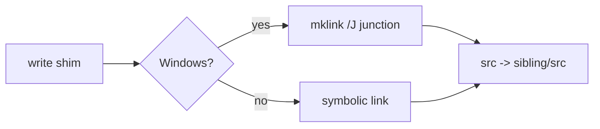

<!--
@license
Copyright (c) ggsuite

Use of this source code is governed by terms that can be
found in the LICENSE file in the root of this package.
-->

# Link TypeScript Shims Through Junctions on Windows

## Motivation

- `TsLinkShims` localizes the TypeScript workspace dependencies of a ticket.
- A pnpm `link:` points at a shim `.gg/ts_links/<name>/`. Its `package.json`
  has `main` and `types` set to `./src/index.ts`.
- The shim's `src` is a link to the sibling's `src/` folder. So vitest, tsc
  and the editor read the sibling's TypeScript source, not a stale or
  missing `dist/`.
- On Windows, creating a symbolic link needs Developer Mode or
  administrator rights. Without them it fails with errno 1314
  ("Dem Client fehlt ein erforderliches Recht").
- On a normal Windows account the tests and every localizing run failed.
- Goal: make gg checks and localizing work on Windows out of the box.

## Strategy

- Keep the shim layout unchanged; only change how the `src` link is made.
- Use a directory junction on Windows. It needs no privileges.
- A junction links folders by absolute path — exactly what the shim needs.
- Keep symbolic links on all other platforms.
- Put the choice into one public helper, used by code and tests alike.

## Implementation 1: The link helper

- New public static `TsLinkShims.createDirectoryLink(link, target)`.
- On Windows it runs `cmd /c mklink /J <link> <target>`.
- A non-zero exit code throws a `FileSystemException` with the output of
  `mklink`.
- Elsewhere it calls `link.createSync(target)` as before.
- The platform branches are coverage-ignored, since each platform runs only
  one of them.

## Implementation 2: Junctions read back like links

- A probe verified that dart:io's `Link` handles junctions the same way:
  - `existsSync()` returns true
  - `targetSync()` returns the same target path
  - `deleteSync()` removes the junction and keeps the target folder
- So the sync check in `write()` needs no Windows-specific code.

## Implementation 3: Use it everywhere

- `write()` uses the helper in both places: when it replaces a link that
  points elsewhere, and when it creates a missing one.
- The two tests that set up a link pointing elsewhere use it too.
- One test used `updateSync`; it now deletes the link and recreates it with
  the helper.
- The class docs explain why Windows gets a junction.

## Result

- All 571 tests pass on Windows without Developer Mode.
- Localizing TypeScript dependencies works on a normal Windows account.

## Open Points

- `mklink` is started as a process, which is slower than a native call.
- Junctions only work for local folders, which is all the shim needs.
