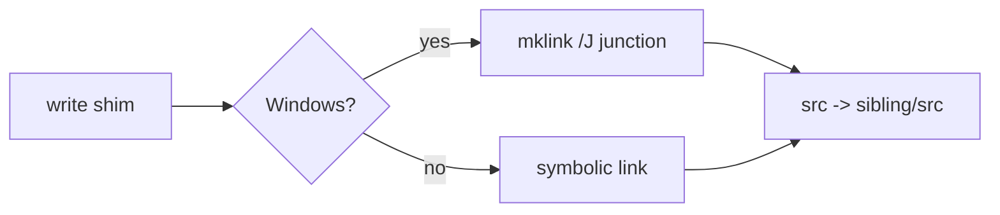

<!--
@license
Copyright (c) ggsuite

Use of this source code is governed by terms that can be
found in the LICENSE file in the root of this package.
-->

# Link TypeScript shims through junctions on Windows

## Motivation

- `change-refs-to-local` links each pnpm dependency of a ticket through a
  shim in `.gg/ts_links/<name>/`
- The shim's `package.json` points `main` and `types` at `./src/index.ts`;
  its `src` is a link to the `src/` folder of the sibling checkout
- So vitest, `tsc` and the editor read the sibling's TypeScript source, not
  a stale or missing `dist/`
- On Windows, a symbolic link needs Developer Mode or administrator rights;
  without them, creating the link failed with errno 1314
- Localizing and the tests of this repo therefore failed on a plain Windows
  account
- Goal: localizing works on Windows without extra rights

## Strategy

- Keep the shim layout, change only how the `src` link is created
- Use a directory junction on Windows: it needs no rights and links a
  folder by its absolute path, which is all the shim needs
- Keep symbolic links on all other platforms
- Put the choice into one public helper for code and tests
- Read junctions back through dart:io's `Link`, as before

## Implementation 1: The link helper

- New public static `TsLinkShims.createDirectoryLink(link, target)`
- On Windows it runs `cmd /c mklink /J <link> <target>`
- A non-zero exit code throws a `FileSystemException` with the output of
  `mklink`
- Elsewhere it calls `link.createSync(target)` as before
- Both branches are coverage-ignored, since each platform runs only one
- The class docs explain why Windows gets a junction

## Implementation 2: Junctions read back like links

- dart:io's `Link` treats a junction like a symbolic link:
  - `existsSync()` returns true
  - `targetSync()` returns the target path
  - `deleteSync()` removes the junction and keeps the target folder
- So `write()` compares and replaces the `src` link on Windows without
  code of its own

## Implementation 3: Use it everywhere

- `write()` uses the helper when it replaces a link that points elsewhere
  and when it creates a missing one
- The two tests that set up a link pointing elsewhere use it too
- One test called `Link.updateSync`, which would create a symbolic link
  again; it now deletes the link and recreates it with the helper
- The README says that the `src` link is a junction on Windows; after the
  review it also names `createDirectoryLink`

## Dependency updates

- dna_ggsuite ^1.0.0 brings the `/gg-review` skill, a blog guide that
  writes to `doc/blog/<yyyy>`, a README guide with
  `scripts/check-readme.js`, and moves the GitHub setup guide to
  `doc/guides/`

## Result

- Localizing TypeScript dependencies works on a plain Windows account
- All tests of this repo pass on Windows without Developer Mode

## Open Points

- `mklink` is started as a process for every link, which is slower than a
  native call
- Junctions link local folders only, which is all the shim needs
