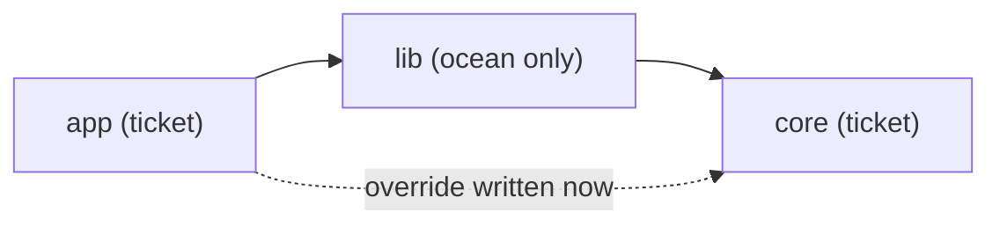

<!--
@license
Copyright (c) ggsuite

Use of this source code is governed by terms that can be
found in the LICENSE file in the root of this package.
-->

# Override every workspace project a package reaches

## Motivation

- Pub and pnpm read overrides from the root package only. A package in local
  or git feature branch mode therefore has to override every sibling it
  reaches, not only the ones its manifest names.
- So far the walk followed workspace projects only. In a gg ticket, a chain
  often leaves the ticket and comes back: `app` (ticket) depends on `lib`
  (only in the ocean), which depends on `core` (ticket). The walk stopped at
  `lib`, so `app` got no override for `core` and resolved it from pub.dev
  while `core` was being changed in the ticket.
- Goal: every ticket project a package really uses gets an override, and
  nothing else does.

## Strategy

- Keep one set for all modes: `ProjectNode.transitiveDependencies`. Local
  mode, `unlocalized-refs`, git feature branch mode and the removal of
  `change-refs-to-pub-dev` all read it, so they cannot drift apart.
- Read the packages outside the ticket from the ocean of the gg workspace,
  located by the markers the graph already knows: `ticket.json` for a
  ticket, `.ocean` (or the legacy `.master`) for the ocean.
- Follow what the resolution really contains, nothing more: an override
  for an unused package still pulls it and its whole dependency tree into
  `pub get`, measured again for this change.

## Implementation 1: the walk through the ocean

- `MultiLanguageGraph.oceanOf` returns the nearest `.ocean`/`.master` above
  a root that carries `ticket.json`, and `null` everywhere else, so the
  ocean itself and plain sibling folders behave as before.
- While building the graph, the declared dependencies that are no ticket
  project are walked through the ocean manifests (regular dependencies
  only). The walk stops at a ticket project, whose ticket copy goes on
  from there, and at a package found nowhere (`path`, `yaml`, …).
- The ticket projects found this way land in
  `ProjectNode.indirectDependencies`. They are no manifest edges: no
  `dependents`, no cycle check, no rewritten reference.
- A broken manifest in the ocean is skipped instead of failing the run; of
  two ocean packages with one name the first by path wins.

## Implementation 2: dev dependencies

- Only the root's dev dependencies count, directly or through the ocean
  (`devOnlyIndirectDependencies`). Those of every other package do not,
  because pub and pnpm never resolve them.
- This also narrows the old walk: a ticket project that an intermediate
  ticket project only dev-depends on is no longer overridden.

## Implementation 3: tests and docs

- New scenarios `through_ocean` (Dart) and `pnpm_through_ocean`: a ticket
  beside its ocean, with chains through one and two ocean packages, an
  ocean copy of a ticket project, dev dependencies, an unknown package and
  a broken manifest.
- One test per overrides command plus unit tests for the walk and for
  `oceanOf`; coverage stays at 100 %.
- `CLAUDE.md` explains the walk, the README says which packages get an
  override.

## Dependency updates

- Version constraints tightened to the latest patch releases of `gg_git`,
  `gg_process`, `gg_project_root`, `gg_publish` and `dna_ggsuite`. Nothing
  in them changes this repo.

## Open Points

- Reading the ocean costs about 40 ms per graph build (warm, ~80 repos).
  A cache would only pay off if commands start to build many graphs.
- The layout of a gg workspace (`.ocean`, `.master`, `ticket.json`) is
  known here and in other tools of the suite. A shared home for it would
  remove that duplication.
